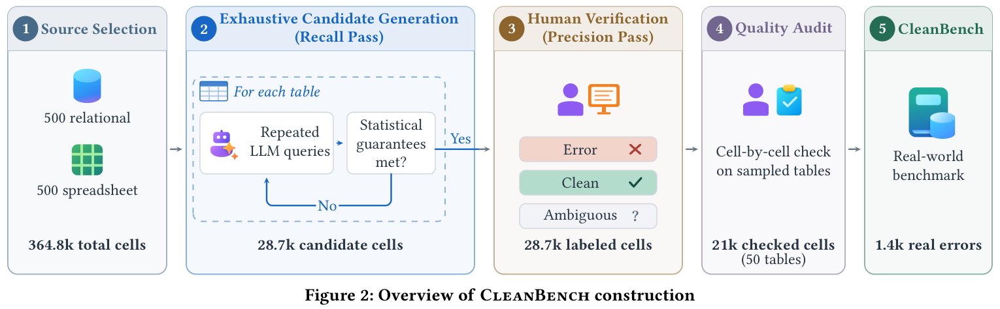
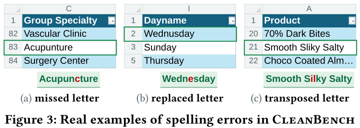
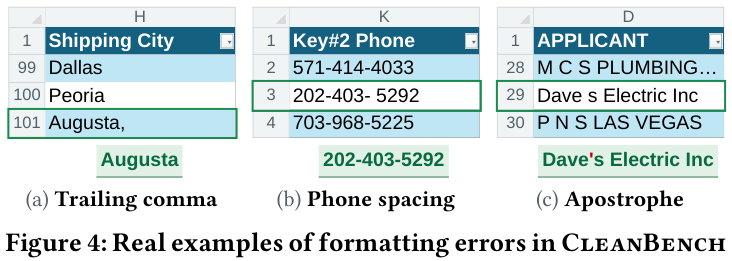
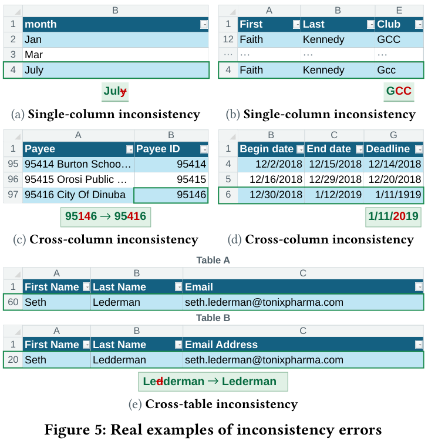
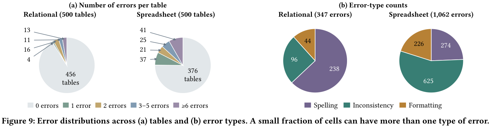
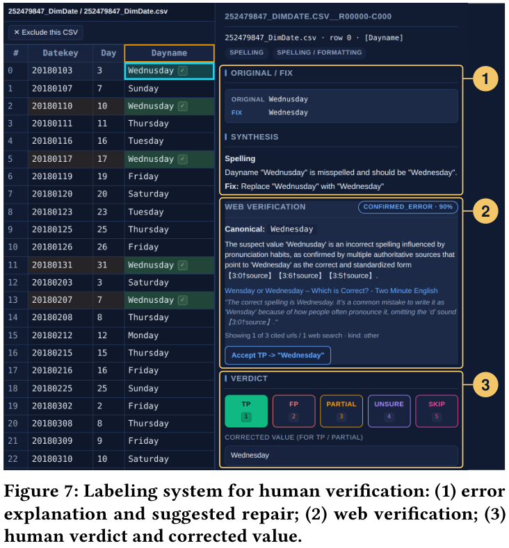

<div align="center">

# CleanBench

### A Real-World Benchmark for Unsupervised Data Cleaning

**Naturally occurring errors. Real-world tables. Human-verified labels.**

[](#benchmark-at-a-glance)
[](#benchmark-at-a-glance)
[](#benchmark-at-a-glance)
[](#use-the-benchmark)
[](LICENSE)

[**Dataset & scorer**](benchmark/README.md) |
[**Annotation workbench**](#run-the-workbench) |
[**Citation**](#citation)

</div>

## Introduction

Detecting errors in real tables is a **needle-in-a-haystack problem**: most cells
are correct, and unfamiliar names, abbreviations, and domain-specific values can
look like errors. A method must find genuine mistakes without "fixing" valid data.

CleanBench evaluates this challenge using **1,000 real-world tables with naturally
occurring errors**, rather than synthetically injected mistakes. It contains
**1,409 human-verified error cells among 364,804 cells**, spanning relational
tables and spreadsheets. Repeated LLM queries exhaustively surface candidates for human
verification until statistical convergence; human labelers then review cell-by-cell 
to ensure quality and coverage.


<p align="center">
  
</p>

## Benchmark at a glance

| Source | Tables | Cells | Error cells | Ambiguous cells |
|---|---:|---:|---:|---:|
| Relational | 500 | 142,459 | 347 | 384 |
| Spreadsheet | 500 | 222,345 | 1,062 | 458 |
| **Total** | **1,000** | **364,804** | **1,409** | **842** |

- **Real errors, not injected noise.** Tables are sampled from public Business
  Intelligence models (`.pbix`) and spreadsheet workbooks (`.xlsx`).
- **Clean tables matter too.** Errors occur in only **168 of 1,000 tables**.
  The remaining tables help test whether methods leave valid data unchanged.
- **Uncertainty is explicit.** Suspicious values without sufficient evidence are
  labeled **ambiguous**, not forced into clean/error decisions. Error cells can
  have multiple accepted repairs.
- **Exact cell-level evaluation.** Measure error detection and end-to-end
  correction quality directly on source tables, focusing on data analytics use
  cases rather than downstream model utility.

### What kinds of errors?

| Error type | What it captures | Example from the paper |
|---|---|---|
| **Spelling** | Missing, replaced, or transposed letters | `Acupunture` → `Acupuncture` |
| **Formatting** | Incorrect punctuation or whitespace | `202-403- 5292` → `202-403-5292` |
| **Inconsistency** | Values that conflict with single-column, cross-column, or cross-table context | `July` among three-letter month abbreviations |

<p align="center">
  
</p>

<br>

<p align="center">
  
</p>

<br>

<p align="center">
  
</p>

<br>

<p align="center">
  
</p>

Error types can overlap, so their counts need not sum to the number of erroneous
cells. The low overall error rate (**about 0.39%**) makes avoiding false positives
as important as finding errors.

## Use the benchmark

The frozen labels, source tables, and cell scorer are in [`benchmark/`](benchmark/README.md).
See its README for schemas, row coordinates, accepted corrections, and scoring rules.
The scorer needs **Python 3.10+** and uses only the standard library.

```bash
git clone https://github.com/kckevinchen/CleanBench.git
cd CleanBench
python -m zipfile -e benchmark/sanitized_sources.zip benchmark/sanitized_sources

# Detect erroneous cells.
python benchmark/eval_cleanbench.py --predictions predictions.jsonl

# Detect errors and supply accepted corrections.
python benchmark/eval_cleanbench.py --predictions predictions.jsonl --task end_to_end
```

Supply your method's predictions as JSONL or CSV:

| Field | Required for | Meaning |
|---|---|---|
| `dataset` | Both tasks | `pbi_500` or `bing21_500` |
| `source` | Both tasks | CSV basename, including `.csv` |
| `row` | Both tasks | Original zero-based data-row index, excluding the header |
| `column` | Both tasks | Column name, with surrounding whitespace trimmed |
| `corrected_value` | End-to-end correction | Proposed replacement value |

Use `--use-row-map` if your predictions use extracted CSV row positions. The
frozen label files use original row coordinates; retain `_ROW_MAP.json`.

**Scoring:** report micro-precision, recall, and F1 from summed cell-level counts.
A wrong repair on an error cell contributes both an FP and an FN. Ambiguous
cells are FP-immune; exclusions and per-cell skips are FP/FN-immune. The released
scorer supports **detection** and **end-to-end correction**; the paper also
discusses repair-only diagnostics. Disclose any supervised use of benchmark labels.

### Released artifacts

| Artifact | Contents |
|---|---|
| [`benchmark_cell.json`](benchmark/benchmark_cell.json) | 1,409 error and 842 ambiguous cell labels, with accepted repairs |
| [`benchmark_row.json`](benchmark/benchmark_row.json) | 46 supplementary row/relation labels, separate from cell scoring |
| [`sanitized_sources.zip`](benchmark/sanitized_sources.zip) | Source CSVs, checksums, and original-row mappings |
| [`ignored.jsonl`](benchmark/ignored.jsonl) | Authoritative exclusion scopes |
| [`neutral_cells.jsonl`](benchmark/neutral_cells.jsonl) | Legacy skip and exclusion annotations |
| [`eval_cleanbench.py`](benchmark/eval_cleanbench.py) | Standard-library cell detection and correction scorer |
| [`release_manifest.json`](benchmark/release_manifest.json) | Release counts and SHA-256 checksums |

Both label files ending in `.json` are **JSONL** (one object per line).

## Run the workbench

The local annotation workbench lets you inspect candidate errors in table context,
record verdicts and repairs, review column inconsistencies, and export evaluation
bundles. It requires **Python 3.10+** and runs **without model credentials**.

<p align="center">
  
  <br>
  <em>Human-verification interface shown in the accompanying manuscript.</em>
</p>

```bash
git clone https://github.com/kckevinchen/CleanBench.git
cd CleanBench
python -m venv .venv
source .venv/bin/activate
pip install -r requirements.txt
./scripts/run_server.sh start --workspace workspace --annotator your-name
```

Open **http://127.0.0.1:8000/**. The server runs in the background and writes
logs to `logs/workbench.log`. Use `./scripts/run_server.sh status`,
`./scripts/run_server.sh restart`, or `./scripts/run_server.sh stop` to manage it.
Pass the same workspace, annotator, and port options when restarting.

On Windows, activate `.venv\Scripts\activate` and run
`python -m src.labeling serve --workspace workspace --annotator your-name`.
Local API documentation is at `/api/docs`.

<details>
<summary><strong>Import, review, export, and back up your annotations</strong></summary>

### Import and review

Import UTF-8 CSVs from the home page. Each file needs a header and at least one
data row; filenames must be unique within a run, and column names must remain
unique after trimming surrounding whitespace. Keep filenames, headers, and row
order fixed after labeling starts.

An optional candidate JSONL file limits review to selected cells:

```json
{"source":"people.csv","row":1,"column":"city","error_type":"typo","suggested_value":"Seattle"}
```

`source`, `row`, and `column` are required. Rows start at zero after the header.
`error_type`, `explanation`, and `suggested_value` are optional. Without a
candidate file, every cell enters the review queue. Imported suggestions remain
proposals until reviewed.

A small synthetic example is included:

```bash
python -m src.labeling import --workspace workspace --run-id demo \
  --csv examples/people.csv --candidates examples/candidates.jsonl
```

Open **Label**, inspect the source context, enter a correction where appropriate,
and save a verdict:

| Verdict | Meaning | Export |
|---|---|---|
| `tp` | Confirmed error | `error` |
| `partial` | Error with an edited scope or correction | `error` |
| `fp` | Valid value | `clean` |
| `unsure` | Insufficient evidence | `ambiguous` |
| `skip` | Outside the scoring task | Immunity record |

Click a source cell to add a missed error (`fn`). For inconsistencies, use the
column board to group values and confirm their accepted forms. Use exclusions
for whole files, rows, or columns that should not be scored.

Keyboard shortcuts: `j`/`k` navigate, `c` focuses the correction, and `n` focuses
the note. `Enter` saves and advances; it defaults to `fp` if no verdict is selected.

### Export and back up

Choose **Export → Eval bundle** to download `benchmark.jsonl`,
`benchmark.ignored.jsonl`, and `MANIFEST.txt`. Export source CSVs from the same
menu. Preserve `_ROW_MAP.json` when exclusions remove rows, so exported positions
can be mapped back to original label coordinates.

Runs are stored under `workspace/outputs/<run-id>/`. Back up the whole run,
including source CSVs and append-only decision histories. Clearing a decision
preserves its history. Workbench exports use `label` and human provenance fields;
the frozen benchmark uses `status`. Keep each export with its matching sources.

</details>

## Development

```bash
python -m pytest -q
python -m ruff check src tests
python -m ruff format --check src tests
```

Node 18+ enables the optional JavaScript tests.

## Citation

If you use CleanBench, please cite the accompanying manuscript:

```bibtex
@misc{chen2026cleanbench,
  title={CleanBench: A Real-World Benchmark for Unsupervised Data Cleaning},
  author={Chen, Kaiwen and He, Yeye and Kariv, Tal and Ariav, Itay and
          Helman, Yair and Chaudhuri, Surajit},
  year={2026},
  note={Manuscript},
  url={https://github.com/kckevinchen/CleanBench}
}
```

## License

Project code is [MIT licensed](LICENSE). This license does not relicense
third-party table content; see [data provenance](benchmark/README.md#provenance).

The six figures in [`docs/assets/`](docs/assets/) are reproduced from the
accompanying CleanBench manuscript by Kaiwen Chen, Yeye He, Tal Kariv, Itay Ariav,
Yair Helman, and Surajit Chaudhuri (Figures 2, 3, 4, 5, 7, and 9).
They retain the manuscript's
[CC BY-NC-ND 4.0 license](https://creativecommons.org/licenses/by-nc-nd/4.0/),
not the code's MIT license. Figures were extracted without changing their content.
